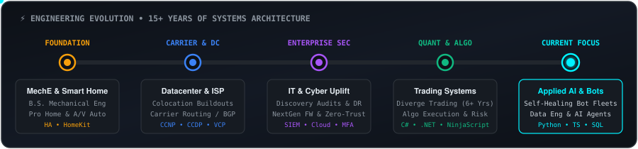
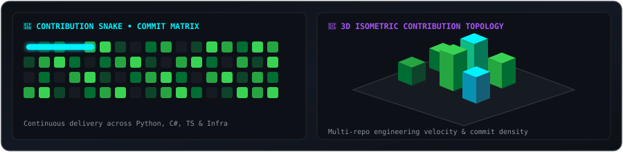

<div align="center">

# ⚡ David Rusoff
### **Trading Systems Engineer • Senior Infrastructure & Network Architect • Cybersecurity Specialist**

[](https://www.linkedin.com/in/david-rusoff-b108bb321/)
[](mailto:dmrusoff@gmail.com)
[](#)

```text
┌────────────────────────────────────────────────────────────────────────┐
│  Datacenter colocation • Enterprise networking • Cloud & cybersecurity │
│  Algorithmic execution systems • Autonomous bots & systems automation  │
└────────────────────────────────────────────────────────────────────────┘
```

---

</div>

## 👨‍💻 About Me

I am a **Trading Systems Engineer and Senior Infrastructure Architect** with **15+ years** of hands-on engineering experience spanning datacenter infrastructure, colocation architecture, enterprise network security, and quantitative trading systems. 

- 📈 **Trading Systems Engineering**: 6+ years at **Diverge Trading** engineering algorithmic execution systems, automated trading utilities, futures risk management tools, and custom NinjaScript / C# indicators.
- 🛡️ **Enterprise Infrastructure & Security**: Over a decade designing carrier-grade service provider networks, colocation facilities, NextGen firewalls, zero-trust networks, and disaster-recovery lifecycles. Led full-scale IT department overhauls—conducting security and asset discovery audits, uplifting network, storage, and compute systems, and deploying segmented enterprise Wi-Fi, VoIP/SIP, and off-site data backup architectures. Established compliance and change-management protocols, MFA hardening, automated patch/imaging pipelines, and end-to-end asset lifecycle management.
- 🤖 **Autonomous Bots & Systems Automation**: Author of high-reliability bot fleets and self-healing daemon supervisors with live incident telemetry and financial data scrapers.
- 🏠 **Smart Home & IoT Engineering**: Lifelong home automation tinkerer with several years of early-career professional experience engineering whole-home and theater automation systems—now building custom local integrations across **Home Assistant** and **Apple HomeKit**.
- 🎓 **Education**: B.S. in Mechanical Engineering • Enterprise Networking, Cloud Computing & Cybersecurity certified • Lifelong learner advancing into Applied AI Systems & Data Engineering.

---

## 🛠️ Technical Arsenal

### Languages & Core Runtimes
<p>
  
  
  
  
  
  
  
</p>

### Frontend, Frameworks & Web Platforms
<p>
  
  
  
  
  
  
</p>

### Infrastructure, Networking & Cybersecurity
<p>
  
  
  
  
  
  
  
  
  
  
  
  
  
</p>

---

## 🚀 Featured Engineering Projects

### 📊 Trading Systems & Financial Intelligence

<table>
  <thead>
    <tr>
      <th width="22%">Project</th>
      <th width="53%">Description</th>
      <th width="25%">Stack</th>
    </tr>
  </thead>
  <tbody>
    <tr>
      <td><a href="https://github.com/dmrusoff/kinetic_room"><b>KINETIC_ROOM</b></a></td>
      <td>Proprietary trading room dashboard featuring real-time Bitcoin tick charts via Liveline, live IPTV news channels, and dynamic futures profit/tick targeting.</td>
      <td><code>React 18</code> <code>TypeScript</code> <code>Tailwind</code> <code>Vite</code> <code>Framer Motion</code></td>
    </tr>
    <tr>
      <td><a href="https://github.com/dmrusoff/Trade-Target-Manager"><b>NinjaTrader 8 Suite</b></a></td>
      <td>Proprietary orderflow and price-action indicator suite (DynamicChannel, SessionsOHLC + 5m OR, CandleBodyAnalyzer, PositionScaler, DeltaLadder).</td>
      <td><code>C#</code> <code>.NET</code> <code>NinjaScript</code> <code>WPF</code></td>
    </tr>
    <tr>
      <td><a href="https://github.com/dmrusoff/Finance-Dashboard"><b>Finance Dashboard</b></a></td>
      <td>Enterprise multi-view financial telemetry platform with database integration, real-time logging, and Rolldown-bundled modular builds.</td>
      <td><code>React</code> <code>Vite 8</code> <code>Supabase</code> <code>TypeScript</code></td>
    </tr>
    <tr>
      <td><a href="https://github.com/dmrusoff/Retirement-Strategy-Analyzer"><b>Retirement Strategy Analyzer</b></a></td>
      <td>Interactive client-side simulation engine forecasting tax strategies (Traditional vs. Roth), safe withdrawal rate curves, and portfolio survivability.</td>
      <td><code>JavaScript</code> <code>HTML5 Canvas</code> <code>CSS3</code> <code>Vercel</code></td>
    </tr>
  </tbody>
</table>

### 🤖 Autonomous Bots & Systems Automation

<table>
  <thead>
    <tr>
      <th width="22%">Project</th>
      <th width="53%">Description</th>
      <th width="25%">Stack</th>
    </tr>
  </thead>
  <tbody>
    <tr>
      <td><b>Watcher</b></td>
      <td>Self-healing daemon supervisor that launches and monitors bot fleets, tracks process health every 30s, executes backoff recovery, and dispatches crash dumps and incident logs via messaging webhooks.</td>
      <td><code>Python 3</code> <code>uv</code> <code>Subprocess API</code> <code>Messaging API</code></td>
    </tr>
    <tr>
      <td><a href="https://github.com/dmrusoff/Newsbot"><b>Newsbot</b></a></td>
      <td>Discord bot conducting headless Forex Factory scraping for high-impact economic releases, macroeconomic regime analysis, and automated alerts.</td>
      <td><code>Python 3</code> <code>discord.py</code> <code>aiohttp</code> <code>BeautifulSoup4</code> <code>curl_cffi</code></td>
    </tr>
    <tr>
      <td><a href="https://github.com/dmrusoff/Discord-Price-Bot"><b>Oilbot</b></a></td>
      <td>Real-time WTI crude oil and commodities streaming price bot with automated Discord presence and webhook relays.</td>
      <td><code>Python 3</code> <code>discord.py</code> <code>Webull API</code> <code>dotenv</code></td>
    </tr>
    <tr>
      <td><b>Media Automation Bot</b></td>
      <td>Resilient messaging client for remote media automation featuring OS TCP keep-alive socket probes, rate-limit recovery, and infinite retry backoff.</td>
      <td><code>Python 3</code> <code>Messaging API</code> <code>HTTPX</code> <code>uv</code></td>
    </tr>
    <tr>
      <td><a href="https://github.com/dmrusoff/Furubot"><b>Furubot</b></a></td>
      <td>High-uptime Discord relay bot with event-loop crash guards, automatic gateway reconnection, and targeted user DM relays.</td>
      <td><code>Node.js</code> <code>discord.js 14</code> <code>undici</code></td>
    </tr>
  </tbody>
</table>

---

## 📜 Certifications & Accreditations

### 🔒 Cybersecurity & Cloud
- **Google Cybersecurity Specialization** — *Google* `(Credential ID: DG324GPE9GSC)`
- **Google Cloud Cybersecurity Certificate** — *Google*
- **Department of the Treasury Cybersecurity Skill Badge** — *Google*
- **Rackspace Cybersecurity Skill Badge** — *Google*
- **Google Crash Course on Python** — *Google* `(Credential ID: 52AOOM618N9D)`

### 🌐 Networking & Virtualization
- **Cisco Certified Network Professional (CCNP)** — *Cisco Routing & Switching*
- **Cisco Certified Design Professional (CCDP)** — *Cisco (ARCH 3.0)*
- **Cisco Certified Network Associate (CCNA)** — *Cisco*
- **VMware Certified Professional (VCP6, VCP5, VCP4)** — *Datacenter Virtualization*
- **VMware Technical Solutions Professional (VTSP) & Sales Professional (VSP)** — *VMware*

### 💾 Data Engineering & Quantitative Analytics
- **Associate Data Engineer in SQL** — *DataCamp* `(Credential ID: 39ec9dba01986f42e819864e51dd08adb1df9cc0)`
- **Quantitative Analyst Track & Applied Finance** — *DataCamp*

---

## ⚡ Systems Architecture & Engineering Telemetry

<div align="center">
  
</div>

<br/>

<div align="center">
  
</div>

<br/>

<div align="center">
  
</div>

---

<div align="center">
  <sub>Engineered with precision • Powered by Python, C#, TypeScript, and Linux</sub>
</div>
